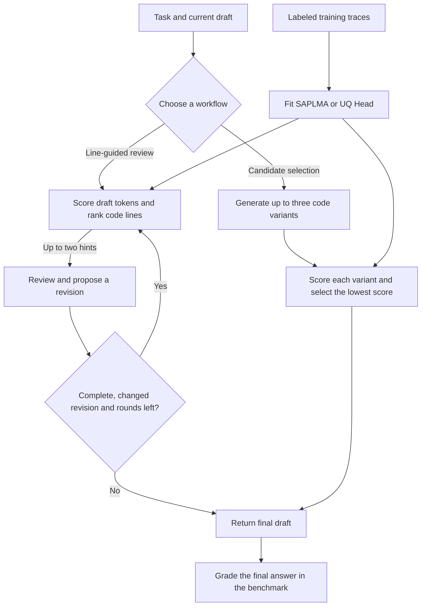

# Uncertainty Guided Agent Reasoning

UGAR is a thesis project on uncertainty-guided reasoning for software
agents.

## Experiments

- [Results and interpretation](RESULTS.md)
- [Setup and notebook index](experiments/README)

Use Python 3.12–3.14 in the project's `.venv` and select the
**Python (UGAR)** kernel. The default configuration uses an NVIDIA GPU
and 4-bit Llama 3.1 8B Instruct through Hugging Face Transformers.

## Line-level uncertainty in the agent loop

Line-guided review takes the maximum token score on each
nonblank code line and passes up to two of the highest-scoring lines to
the reviewer. The reviewer gets the task, the current draft, and those
hints. It returns a short review and one fenced revision. The loop stops
when the draft stays the same, the round limit is reached, or the reviewer
returns no complete, nonempty code block. In the last case it keeps the
current draft.

The candidate-selection variant requests up to three distinct code blocks
in one call. It scores each candidate by its highest predicted defect
score over code tokens and selects the candidate with the lowest score.
If no candidate has a usable score, it keeps the current draft.



## Train and run a loop from scratch

1. Follow the [environment setup](experiments/README#setup). Run the
   examples below from the repository root with the project's `.venv`.
   Docker is needed for the Python benchmark checks in
   [notebook 6](experiments/06_agent_loop.ipynb).
2. Load training examples and fit a probe once. This example uses the
   MBPP pilot split. To use UQ Head, import and instantiate
   `UncertaintyQuantificationHead` in place of `SAPLMA`.

   ```python
   from datasets.benchmarks import PILOT_LIMITS, load_examples, split_examples
   from src.evaluation import TraceStore
   from src.methods import SAPLMA

   store = TraceStore(quantize=True)
   splits = split_examples(load_examples("mbpp"), PILOT_LIMITS)
   rows = [store.load(example) for example in splits["train"]]
   validation = [store.load(example) for example in splits["validation"]]
   estimator = SAPLMA().fit(
       [row["trace"] for row in rows],
       [row["labels"] for row in rows],
       validation=(
           [row["trace"] for row in validation],
           [row["labels"] for row in validation],
       ),
   )
   print(estimator.training_history[-1])
   ```

3. Generate an initial draft and give `create_agent` a scoring callback.
   The callback replays the current draft with the task prompt and uses
   tokenizer offsets to map scores to lines. Each review round uses the
   latest draft.

   ```python
   from torch import Tensor

   from src.agent_loop import create_agent, rank_lines

   extractor = store.extractor
   task = "Write a Python function that counts vowels. Return fenced code."
   initial = {"task": task, "draft": extractor.generate(task)}

   def score_tokens(draft: str) -> tuple[Tensor, list[tuple[int, int]]]:
       offsets = extractor.tokenizer(
           draft, add_special_tokens=False, return_offsets_mapping=True
       )["offset_mapping"]
       scores, = estimator.predict_uncertainty([extractor(task, draft)])
       return scores, offsets

   def score_lines(draft: str) -> list[tuple[int, str]]:
       if not draft.strip():
           return []
       scores, offsets = score_tokens(draft)
       line_ids = []
       for start, end in offsets:
           text = draft[start:end].lstrip()
           anchor = end - len(text) if text else start
           line_ids.append(draft.count("\n", 0, anchor))
       return rank_lines(draft, scores, line_ids, limit=2)

   agent = create_agent(extractor.generate, score=score_lines, max_rounds=2)
   result = agent.invoke(initial)
   print(result["draft"])
   ```

4. To try candidate selection on the same draft, reuse `score_tokens`
   and return the maximum score inside each candidate's code fence.

   ```python
   from src.agent_loop import code_block, create_agent_candidates

   def score_candidate(candidate: str) -> float:
       block = code_block(candidate)
       assert block is not None
       start, end = block.span("code")
       scores, offsets = score_tokens(candidate)
       return max(
           float(score)
           for score, (left, right) in zip(scores, offsets, strict=True)
           if candidate[max(start, left):min(end, right)].strip()
       )

   def generate_candidates(prompt: str) -> str:
       return extractor.generate(prompt, max_new_tokens=768)

   agent = create_agent_candidates(generate_candidates, score_candidate)
   print(agent.invoke(initial)["draft"])
   ```

   Both graph factories accept a generation callback. Notebook 6 shows
   the comparison and grading. [Agent experiment](experiments/06_agent_loop.ipynb)

## Project structure

```text
datasets/
├── benchmarks.py       Dataset loading and task splits
└── repair.py           Repair cases and archived assertions
experiments/
├── data_*.ipynb        Dataset examples and split counts
├── 01–05 notebooks     One executed notebook per estimator
├── 06_agent_loop.ipynb  Uncertainty-guided agent review
├── test.ipynb          Original model-loading notebook
└── README              Setup and experiment settings
src/
├── traces.py           Transformers feature extraction
├── methods.py          Five estimators with a shared interface
├── evaluation.py       Trace caching, benchmark execution, and grading
└── agent_loop.py       LangGraph review and revision
requirements.txt        Python dependencies
```

## Authors

* **Marsel Berheev** (`m.berheev@innopolis.university`)
  * Author of paper
* **Vladimir Ivanov** (`v.ivanov@innopolis.ru`)
  * Thesis supervisor
* **Georgy Andruschenko**
  * Thesis consultant

## Acknowledgments

The experiments build on Georgy Andruschenko's work on code hallucination
detection and the neighboring `llm-uncertainty-layer` repository.
[Efficient Hallucination Detection in Automatic Code Generation](https://aclanthology.org/2026.findings-acl.2143/)

## License

Distributed under [MIT License](./LICENSE)
