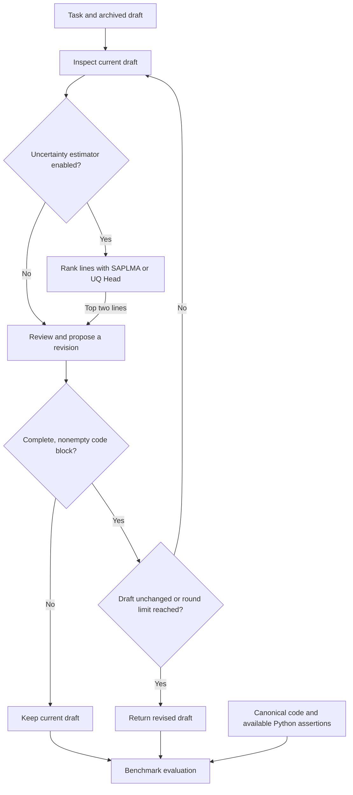

# Experiment results

SAPLMA had the highest line-level PR-AUC on MBPP, HumanEval, and
HumanEval-Java. Lookback Lens the best on Defects4J and achieved the highest
token-level PR-AUC on three of the four benchmarks.

## Line-level

| Benchmark | Defective lines | Positive rate | Lookback Lens | UQ Head | ICR Probe | SAPLMA | HaloScope |
| --- | ---: | ---: | ---: | ---: | ---: | ---: | ---: |
| MBPP | 54 / 509 | 10.61% | 0.7021 | 0.3892 | 0.1429 | **0.7372** | 0.0718 |
| HumanEval | 55 / 484 | 11.36% | 0.5595 | 0.2270 | 0.3562 | **0.5976** | 0.0862 |
| HumanEval-Java | 15 / 155 | 9.68% | 0.2903 | 0.3446 | 0.1435 | **0.3469** | 0.0662 |
| Defects4J | 148 / 448 | 33.04% | **0.8959** | 0.8180 | 0.5807 | 0.8633 | 0.2083 |

On HumanEval-Java, SAPLMA and UQ Head differed by just 0.0023 in
line-level PR-AUC, with 15 positive lines in the test set. On HumanEval,
SAPLMA ranked lines best by PR-AUC, while ICR Probe achieved the highest
line F1 at the validation-selected threshold (0.3929 versus 0.2880 for
SAPLMA). SAPLMA caught all 55 positive lines at that threshold, with
16.82% precision.

## Token and response results

| Benchmark | Test responses | Token-level leader | Response-level leader |
| --- | ---: | --- | --- |
| MBPP | 74 | SAPLMA (0.6876) | SAPLMA (0.8115) |
| HumanEval | 46 | Lookback Lens (0.5354) | SAPLMA (0.6066) |
| HumanEval-Java | 36 | Lookback Lens (0.3021) | UQ Head (0.4484) |
| Defects4J | 86 | Lookback Lens (0.9413) | Lookback Lens (0.6586) |

HumanEval-Java shows how the choice of scoring unit can change the
ranking. A line or response takes the maximum score of its annotated
tokens, so one high-scoring token can raise the entire unit's score.
The full notebooks also report ROC-AUC, average precision, precision,
recall, F1, and the chosen thresholds.

## DIsscusion

The run used a single fixed seed and 242 held-out responses in total.
Each benchmark was split by task, and each method's F1 thresholds were
chosen on validation data. The labels come from diffs between archived
generations and canonical solutions. Some archived failing generations
have zero positive diff labels and count as clean under this definition.

The scores describe defect detection on archived text replayed through
4-bit Llama 3.1 8B Instruct. They support comparisons within each benchmark
and scoring level under this setup. Positive rates vary across benchmarks
and levels, and the single run leaves small gaps uncertain.

## Uncertainty-guided agent review

The LangGraph pilot used four held-out tasks per benchmark. Each condition
started from the same archived draft and had one review and revision round.
SAPLMA and UQ Head each put up to two lines ranked by token uncertainty
into the review prompt. The plain-review control used the same generation
budget.
[Executed agent notebook](experiments/06_agent_loop.ipynb)

| Review condition | MBPP passed | HumanEval passed | HumanEval-Java similarity | Defects4J similarity |
| --- | ---: | ---: | ---: | ---: |
| Archived draft | 0/4 | 0/4 | 0.5843 | 0.2808 |
| Plain review | 1/4 | 0/4 | 0.5318 | 0.2453 |
| UQ Head | 2/4 | 1/4 | 0.6399 | 0.3129 |
| SAPLMA | 2/4 | 0/4 | 0.5831 | 0.3107 |

UQ Head passed 3 of 8 Python tasks, SAPLMA passed 2 of 8, and plain
review passed 1 of 8. The Python pass counts use archived assertions
checked in Docker. Both guided conditions improved mean Java code-token
similarity over plain review. Java scores measure similarity to the
reference patch, so functional correctness on those tasks remains unverified.
The four-task samples make these pilot results sensitive to individual tasks.

### Agent pipeline

The benchmark runs one review round per condition. The graph can repeat
inspection when given a larger round budget. Evaluation uses the returned
draft for code-token comparison and checks the archived Python assertions
where available.

### Candidate selection

On the same 16 held-out tasks, the new agent proposed up to three distinct
code variants in one call. SAPLMA and UQ Head scored the same pool
independently and each selected the variant with the lowest maximum
token defect score. Candidate selection had a 768-token generation cap.
Line-guided review had a 256-token cap. [Notebook comparison](experiments/06_agent_loop.ipynb)

| Estimator | Python passes, review | Python passes, selection | HumanEval-Java similarity, review → selection | Defects4J similarity, review → selection |
| --- | ---: | ---: | ---: | ---: |
| UQ Head | 3/8 | 0/8 | 0.6399 → 0.4923 | 0.3129 → 0.1538 |
| SAPLMA | 2/8 | 1/8 | 0.5831 → 0.4923 | 0.3107 → 0.1538 |

Line-guided review passed more Python tasks and produced higher mean
reference similarity on both Java benchmarks in this pilot. Candidate
pools averaged three distinct variants on MBPP and 1.5 on Defects4J.
Java functional correctness was unverified in both approaches.
