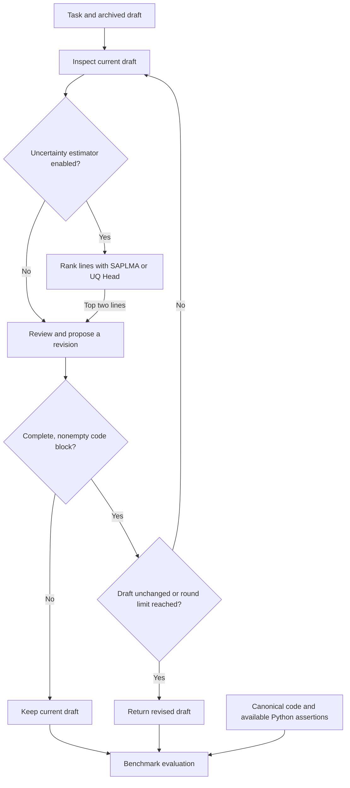

# Experiment results

## Five-epoch detector baseline

SAPLMA had the highest line-level PR-AUC on MBPP, HumanEval, and
HumanEval-Java. Lookback Lens the best on Defects4J and achieved the highest
token-level PR-AUC on three of the four benchmarks.

## Line-level

| Benchmark | Defective lines | Positive rate | Lookback Lens | UQ Head | ICR Probe | SAPLMA | HaloScope |
| --- | ---: | ---: | ---: | ---: | ---: | ---: | ---: |
| MBPP | 54 / 509 | 10.61% | 0.7021 | 0.3892 | 0.1429 | **0.7372** | 0.0718 |
| HumanEval | 55 / 484 | 11.36% | 0.5595 | 0.2270 | 0.3562 | **0.5976** | 0.0862 |
| HumanEval-Java | 15 / 155 | 9.68% | 0.2903 | 0.3446 | 0.1435 | **0.3469** | 0.0662 |
| Defects4J | 148 / 448 | 33.04% | **0.8959** | 0.8180 | 0.5807 | 0.8633 | 0.2083 |

On HumanEval-Java, SAPLMA and UQ Head differed by just 0.0023 in
line-level PR-AUC, with 15 positive lines in the test set. On HumanEval,
SAPLMA ranked lines best by PR-AUC, while ICR Probe achieved the highest
line F1 at the validation-selected threshold (0.3929 versus 0.2880 for
SAPLMA). SAPLMA caught all 55 positive lines at that threshold, with
16.82% precision.

## Token and response results

| Benchmark | Test responses | Token-level leader | Response-level leader |
| --- | ---: | --- | --- |
| MBPP | 74 | SAPLMA (0.6876) | SAPLMA (0.8115) |
| HumanEval | 46 | Lookback Lens (0.5354) | SAPLMA (0.6066) |
| HumanEval-Java | 36 | Lookback Lens (0.3021) | UQ Head (0.4484) |
| Defects4J | 86 | Lookback Lens (0.9413) | Lookback Lens (0.6586) |

HumanEval-Java shows how the choice of scoring unit can change the
ranking. A line or response takes the maximum score of its annotated
tokens, so one high-scoring token can raise the entire unit's score.
The full notebooks also report ROC-AUC, average precision, precision,
recall, F1, and the chosen thresholds.

## DIsscusion

The run used a single fixed seed and 242 held-out responses in total.
Each benchmark was split by task, and each method's F1 thresholds were
chosen on validation data. The labels come from diffs between archived
generations and canonical solutions. Some archived failing generations
have zero positive diff labels and count as clean under this definition.

The scores describe defect detection on archived text replayed through
4-bit Llama 3.1 8B Instruct. They support comparisons within each benchmark
and scoring level under this setup. Positive rates vary across benchmarks
and levels, and the single run leaves small gaps uncertain.

## Fifteen-epoch detector training

This earlier run trained UQ Head, ICR Probe, and SAPLMA for fifteen epochs
on the full training splits. The table shows the final epoch.
Training and validation loss are mean
binary cross-entropy over labeled tokens. The AUC columns measure
validation token ranking and held-out line ranking. The estimator
notebooks show the histories for their current epoch settings.
[UQ Head](experiments/02_uq_head.ipynb),
[ICR Probe](experiments/03_icr_probe.ipynb), [SAPLMA](experiments/04_saplma.ipynb)

| Estimator | Benchmark | Train loss | Validation loss | Validation token PR-AUC | Validation token ROC-AUC | Test line PR-AUC |
| --- | --- | ---: | ---: | ---: | ---: | ---: |
| UQ Head | MBPP | 0.4498 | 0.3630 | 0.4858 | 0.8534 | 0.4516 |
| UQ Head | HumanEval | 0.3835 | 0.5803 | 0.3034 | 0.5298 | 0.2969 |
| UQ Head | HumanEval-Java | 0.4662 | 0.3467 | 0.3113 | 0.7015 | 0.3088 |
| UQ Head | Defects4J | 0.4047 | 0.4091 | 0.8414 | 0.8852 | 0.8769 |
| ICR Probe | MBPP | 0.5235 | 0.4502 | 0.1266 | 0.4053 | 0.1614 |
| ICR Probe | HumanEval | 0.4056 | 0.5919 | 0.4055 | 0.6857 | 0.3306 |
| ICR Probe | HumanEval-Java | 0.4639 | 0.3642 | 0.1535 | 0.6209 | 0.1393 |
| ICR Probe | Defects4J | 0.6486 | 0.6089 | 0.4990 | 0.6793 | 0.5941 |
| SAPLMA | MBPP | 0.0214 | 0.7332 | 0.6106 | 0.9145 | 0.7213 |
| SAPLMA | HumanEval | 0.0529 | 2.7960 | 0.3249 | 0.5440 | 0.6990 |
| SAPLMA | HumanEval-Java | 0.0907 | 0.9625 | 0.2006 | 0.6912 | 0.4379 |
| SAPLMA | Defects4J | 0.0754 | 1.3443 | 0.6715 | 0.8018 | 0.8253 |

On Defects4J, UQ Head's validation loss fell from 0.6443 at epoch 5 to
0.4091 at epoch 15. On HumanEval, SAPLMA's validation loss rose from
1.7897 to 2.7960 over the same interval. The rise indicates worse
validation probability estimates, even though its held-out line PR-AUC
increased from 0.5976 to 0.6990.

## Uncertainty-guided agent review

The LangGraph pilot used four held-out tasks per benchmark. Each review
condition started from the same archived draft and had one revision round.
The direct model received the original task and generated one answer.
SAPLMA trained for 3 epochs and UQ Head for 10. Each estimator put up to
two lines ranked by token uncertainty into the review prompt. The
plain-review control used the same generation budget.
[Executed agent notebook](experiments/06_agent_loop.ipynb)

| Review condition | MBPP passed | HumanEval passed | HumanEval-Java similarity | Defects4J similarity |
| --- | ---: | ---: | ---: | ---: |
| Direct model | 2/4 | 1/4 | 0.3738 | 0.1560 |
| Archived draft | 0/4 | 0/4 | 0.5843 | 0.2808 |
| Plain review | 1/4 | 0/4 | 0.5318 | 0.2453 |
| UQ Head | 2/4 | 0/4 | 0.6399 | 0.3148 |
| SAPLMA | 2/4 | 0/4 | 0.6399 | 0.3076 |

Direct generation passed 3 of 8 Python tasks. UQ Head and SAPLMA each
passed 2 of 8 with line-guided review. Plain review passed 1 of 8.
The Python pass counts use archived assertions
checked in Docker. Both guided conditions improved mean Java code-token
similarity over plain review. Java scores measure similarity to the
reference patch, so functional correctness on those tasks remains unverified.
The four-task samples make these pilot results sensitive to individual tasks.

### Agent pipeline

The benchmark runs one review round per condition. The graph can repeat
inspection when given a larger round budget. Evaluation uses the returned
draft for code-token comparison and checks the archived Python assertions
where available.

### Candidate selection

On the same 16 held-out tasks, the new agent proposed up to three distinct
code variants in one call. SAPLMA and UQ Head scored the same pool
independently and each selected the variant with the lowest maximum
token defect score. Both approaches trained SAPLMA for 3 epochs and
UQ Head for 10. Candidate selection had a 768-token generation cap.
Line-guided review had a 256-token cap. [Notebook comparison](experiments/06_agent_loop.ipynb)

| Estimator | Python passes, review | Python passes, selection | HumanEval-Java similarity, review → selection | Defects4J similarity, review → selection |
| --- | ---: | ---: | ---: | ---: |
| UQ Head | 2/8 | 1/8 | 0.6399 → 0.4096 | 0.3148 → 0.1587 |
| SAPLMA | 2/8 | 2/8 | 0.6399 → 0.4923 | 0.3076 → 0.1538 |

With UQ Head, line-guided review passed one more Python task. With
SAPLMA, both approaches passed two. Line-guided review produced higher
mean reference similarity on both Java benchmarks with either estimator.
Candidate pools averaged three distinct variants on MBPP and 1.5 on
Defects4J. Java functional correctness was unverified in both approaches.

### Uncertainty metrics against the direct model

The same fitted estimator scores both replies after generation. PR-AUC
and F1 use nonblank output lines, with unmatched lines labeled positive
by a diff against the reference. The F1 threshold is selected on the
archived validation split. Each delta averages four paired differences
in maximum code-token score, guided minus direct. Negative values
indicate lower estimated uncertainty. [Agent evaluation protocol](experiments/README#agent-evaluation)

| Benchmark | Estimator | Direct PR-AUC / F1 | Review PR-AUC / F1 | Selection PR-AUC / F1 | Review delta | Selection delta |
| --- | --- | ---: | ---: | ---: | ---: | ---: |
| MBPP | UQ Head | 0.9953 / 0.0377 | 1.0000 / 0.1333 | 1.0000 / 0.8571 | +0.0389 | +0.0744 |
| MBPP | SAPLMA | 0.9805 / 0.0377 | 1.0000 / 0.3529 | 1.0000 / 0.0000 | +0.0916 | -0.1339 |
| HumanEval | UQ Head | 0.9217 / 0.8571 | 0.7612 / 0.7308 | 0.8948 / 0.8395 | +0.0003 | ≈0 |
| HumanEval | SAPLMA | 0.9459 / 0.8542 | 0.7062 / 0.7059 | 0.9479 / 0.8533 | -0.0137 | -0.0922 |
| HumanEval-Java | UQ Head | 0.9168 / 0.0000 | 0.8166 / 0.0000 | 0.8422 / 0.0000 | +0.0004 | +0.0002 |
| HumanEval-Java | SAPLMA | 0.9549 / 0.5797 | 0.9856 / 0.8000 | 0.9349 / 0.4390 | -0.1311 | -0.1191 |
| Defects4J | UQ Head | 0.9558 / 0.9861 | 0.9563 / 0.9756 | 0.9996 / 0.9520 | +0.0572 | -0.1471 |
| Defects4J | SAPLMA | 0.9904 / 0.9185 | 0.9915 / 0.9457 | 0.9967 / 0.8784 | -0.0313 | -0.0034 |

Unmatched lines are common, especially on Defects4J where 71 of 73
direct-model lines were positive. Interpret PR-AUC with these class
counts and F1 with the fixed validation threshold. On MBPP, SAPLMA
candidate selection reduced uncertainty by 0.1339 and passed 2 of 4
tasks, the same count as direct generation.
